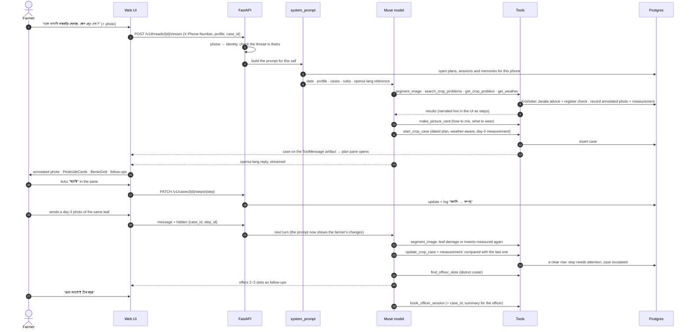

# KrishiBondhu.AI: architecture

How the pieces fit together and how they are deployed. For what the project is, see the
[README](README.md).

## Deployment

One FastAPI app on Vercel is the whole deployment: it serves the API and the static Next.js export
(`main.py`, `tool.vercel` in `pyproject.toml`, `vercel.json`); the build script builds `frontend/dist`.

- **Postgres** (Aiven) holds everything structured: farmers, crop cases, image records and leaf
  measurements, officer bookings and threads (one row-level security policy per table, so a farmer's
  queries only ever see their own rows), conversation checkpoints and long-term memory
  (`persistence.py`), and the reference data (`agri` schema).
- **Vercel Blob** (a public store connected to the project) holds the image files; Postgres keeps their
  links (`gallery.py`).

Vercel does not touch the database schema, so before deploying a schema change, run these against the
database:

```bash
uv run krishi-db migrate      # app tables, row-level security, officer roster (idempotent)
uv run krishi-db load-agri    # pesticide register + Krishoker Janala advice from assets/agri.db
```

There is no auth yet: the `X-Phone-Number` header is the user identity, and each number only sees its own
conversations.

### Project settings

| Variable | What |
| --- | --- |
| `ENVIRONMENT` | `production` hides `/docs`, `/redoc` and `/openapi.json` |
| `META_API_KEY`, `META_BASE_URL`, `MODEL_NAME` | Muse model endpoint |
| `SEGMENT_MODEL_NAME`, `TRANSCRIBE_MODEL_NAME`, `IMAGE_MODEL_NAME` | SAM 3.1, Meta ASR and Muse Image (defaults set) |
| `DB_URI` | Postgres connection string |
| `LANGSMITH_*` | tracing |

The connected Blob store sets its own credentials.

## Architecture

### The full flow: farmer → agent → tools → UI

```mermaid
flowchart TB
    farmer(["👩‍🌾 Farmer<br/>text · up to 2 photos · taps on cards, forms, the plan"])

    subgraph WEB["Web UI · static Next.js export (frontend/)"]
        direction TB
        gate["ProfileGate<br/>phone · name · division / district / area"]
        composer["Composer<br/>text + photos (downscaled to 1280 px JPEG)"]
        stream["useChat (lib/chat.ts)<br/>header X-Phone-Number<br/>context: profile + case_id of the open plan"]
        turns["buildTurns<br/>user message · tool steps · final reply"]
        activity["ToolActivity<br/>Bangla narration per tool, folded into '৪টি ধাপ সম্পন্ন'"]
        progressive["progressive.ts<br/>re-render only on complete statements"]
        renderer["OpenUI Renderer + library.ts<br/>stock cards, tables, forms, follow-ups, sources"]
        custom["Custom components<br/>Map (Leaflet + OSM) · BentoGrid (Commons photos)<br/>PesticideCards (dose + WHO hazard) · theme-aware charts"]
        zoom["ImageZoom<br/>any reply photo full size + credit"]
        pane["CasePane<br/>plan timeline (treatment or cultivation): progress ring, track,<br/>phases, steps with sources, warning signs, measured leaf damage,<br/>photos, activity log"]
        sidebar["Sidebar (collapsible; a drawer on phones)<br/>plans · officer sessions · photo folder · conversations"]
    end

    subgraph SERVER["FastAPI on Vercel (main.py)"]
        direction TB
        auth["api/deps.py, threads.py<br/>X-Phone-Number → identity (E.164)<br/>threads owned by that phone"]
        threads[("Threads<br/>checkpoints in Postgres (AsyncPostgresSaver)")]

        subgraph AGENT["krishi_advisor graph · create_agent (agent/)"]
            direction TB
            prompt["system_prompt middleware<br/>date block · farmer profile · open plans · upcoming officer sessions<br/>long-term memories · (+ full plan of the one open in the pane)<br/>persona & rules · openui-lang reference"]
            model{{"Muse model (META_BASE_URL)<br/>reads text + photos, plans tool calls,<br/>writes the reply in openui-lang"}}
            guard["content_filter_guard<br/>retry once, then Bangla fallback"]
            limit["ToolCallLimit<br/>search_images, make_picture_card ≤ 2 per run"]
            toolnode["Tool node"]
        end

        subgraph API["FastAPI routes (main.py, mounted on the server)"]
            direction TB
            casesApi["/v1/cases<br/>list · tick / move / skip a step · close · delete"]
            imagesApi["/v1/images<br/>farmer's annotated photos"]
            bookingsApi["/v1/bookings<br/>list · cancel"]
            pestApi["/v1/pesticides<br/>register lookups"]
            chatApi["/v1/chat · /v1/chat/stream · /v1/chat/history<br/>plain-text channels (WhatsApp later)"]
        end
    end

    subgraph TOOLS["Tools (src/meta_hackathon/tools/)"]
        direction TB
        kb["search_crop_problems · get_crop_problem<br/>Krishoker Janala advice (DAE), every chemical<br/>checked against the pesticide register"]
        web["search_internet<br/>live web search + cited sources"]
        weather["get_weather<br/>now · next 24 h · daily"]
        geo["geocode_location<br/>places in Bangladesh"]
        seg["segment_image<br/>the model names what it sees, SAM marks it;<br/>counts insects, measures lesion % of the leaf (lesions.py)"]
        card["make_picture_card<br/>drawn step cards, Bangla captions and doses rendered by us"]
        imgs["search_images<br/>reference photos with author & licence"]
        findP["find_registered_pesticides<br/>crop + pest → ingredients, brands, reg no, dose"]
        lookP["lookup_pesticide_product<br/>brand / reg no → registered uses"]
        caseTools["start_crop_case · start_cultivation_plan<br/>update / get_crop_case<br/>dated steps (or days from day 0), phases, outcomes, photos,<br/>measurements: a measured rise escalates the case"]
        booking["find_officer_slots · book_officer_session<br/>change_officer_booking<br/>district officer roster, Sun–Thu slots"]
        memory["create_or_update_user_memory<br/>fetch_user_memory"]
    end

    subgraph EXT["External services"]
        direction TB
        muse["Meta Muse API<br/>chat model + web_search"]
        sam["SAM 3.1 (Meta Responses API)"]
        museImage["Muse Image (Meta Responses API)"]
        meteo["Open-Meteo<br/>geocoding + forecast"]
        osm["OpenStreetMap Nominatim"]
        commons["Wikimedia Commons API"]
        smith["LangSmith tracing"]
    end

    subgraph STORE["Data"]
        direction TB
        pestDb[("Postgres · agri schema<br/>DAE pesticide register (Dec 2020)<br/>Krishoker Janala: 998 problems on 122 crops")]
        hazards["hazards.py<br/>WHO hazard class per ingredient"]
        appDb[("Postgres · app tables, row-level security per farmer<br/>farmers · crop_cases · images (with measurements) · threads · officers · bookings")]
        memDb[("Postgres store<br/>long-term memories per farmer")]
        blobStore[("Vercel Blob<br/>farmers' photos · annotated photos · picture cards")]
    end

    %% Farmer → UI → server
    farmer --> gate --> composer --> stream
    stream -- "POST turn · SSE stream" --> auth --> threads --> prompt
    auth -- "photos become links" --> blobStore
    appDb -. "open plans + sessions every turn" .-> prompt
    memDb -. "memories every turn" .-> prompt

    %% Agent loop
    prompt --> model
    model -- "tool calls" --> limit --> toolnode
    toolnode -- "tool results" --> model
    model -- "blocked / empty" --> guard --> model
    model -. traces .-> smith
    model <--> muse

    %% Tools → services and data
    toolnode --> kb & web & weather & geo & seg & card & imgs & findP & lookP & caseTools & booking & memory
    kb --> pestDb
    booking --> appDb
    memory --> memDb
    web --> muse
    weather --> meteo
    geo --> osm
    seg --> sam
    seg --> blobStore
    seg -- "who / which thread / labels / measurement" --> appDb
    card --> museImage
    card --> blobStore
    imgs --> commons
    findP --> pestDb
    lookP --> pestDb
    findP --> hazards
    lookP --> hazards
    caseTools --> appDb

    %% Back to the UI
    model -- "openui-lang reply (streamed)" --> threads
    threads -- "messages + tool results" --> stream --> turns
    turns --> activity
    turns --> progressive --> renderer --> custom
    renderer --> zoom
    turns -- "case on the ToolMessage artifact" --> pane

    %% UI actions back into the loop
    renderer -- "follow-ups · forms · buttons" --> composer
    pane -- "better / same / worse · send photo · ask<br/>(+ hidden case_id / step_id)" --> composer
    pane -- "tick off · move date · skip · close" --> casesApi --> appDb
    sidebar --> imagesApi --> appDb
    sidebar -- "threads.search" --> threads
    sidebar --> casesApi
    sidebar --> bookingsApi --> appDb
    custom -. "photos" .-> blobStore
    custom -. "Commons thumbnails" .-> commons
    pestApi --> pestDb
    chatApi --> AGENT
    renderer --> farmer
    pane --> farmer
```



### One turn, step by step



## How it fits together

- **Agent** (`src/meta_hackathon/agent/`): LangChain `create_agent` on Muse, with tools in
  `src/meta_hackathon/tools/`:
  - `search_crop_problems` / `get_crop_problem`: Krishoker Janala, the DAE's advice for 998 problems on
    122 crops, ranked with Bangla spelling normalisation; every chemical it names is checked against the
    pesticide register for that crop (`knowledge.py`).
  - `find_registered_pesticides` / `lookup_pesticide_product`: the DAE pesticide register (Dec 2020),
    shown as cards with the WHO hazard class (`pesticides.py`, `hazards.py`).
  - `segment_image` (SAM 3.1): below. `make_picture_card` (Muse Image): drawn cards for farmers who find
    reading hard, with no generated text; captions and doses are rendered by the tool.
  - `get_weather` (Open-Meteo), `geocode_location` (OpenStreetMap Nominatim),
    `search_internet` (Muse web search), `search_images` (Wikimedia Commons).
  - `start_crop_case` / `start_cultivation_plan` / `update_crop_case` / `get_crop_case`: plans (below).
  - `find_officer_slots` / `book_officer_session` / `change_officer_booking`: sessions with the district's
    agriculture officer (`bookings.py`, roster in `assets/officers.csv`).
  - `create_or_update_user_memory` / `fetch_user_memory`: lasting facts about the farmer (land, crops,
    soil, what worked), in the LangGraph Postgres store under `("memories", phone)`.
- **Photo evidence** (`tools/segment.py`, `lesions.py`): the main model names what it sees and SAM is asked
  for that name, then what it looks like, then generic words, since SAM finds appearances rather than
  diagnoses. Each problem is measured in its own way: insects by count, disease by lesions from fixed queries
  as a share of a leaf found with point prompts, so photos stay comparable whatever the model calls the
  problem. Measurements are stored on `images` and attached to a plan by id, so the agent cannot invent one.
  Insects not found are left out rather than counted as zero, and a first lesion reading of zero is not kept.
  A rise (at least 3 points and 25% for lesions, 10 insects and 50% for a count) marks the check worse and
  escalates the plan; a fall changes nothing until the agent has looked at the photo.
- **Plans** (`src/meta_hackathon/cases.py`): two kinds on one timeline of dated steps (actions, and checks
  where the farmer reports better / same / worse):
  - *treatment*: a diagnosed problem, from today to the last check;
  - *cultivation*: growing something (a rice season, mushrooms, a fertiliser schedule), with steps counted
    in days from a day 0 (transplanting, sowing, spawning) so moving that date moves every step, grouped
    into phases, with a cited source for every dose.

  The agent sees the farmer's open plans in its prompt every turn; the web UI shows a plan beside the chat
  and changes it through `/v1/cases`. Every change, by either side, goes into the plan's activity log.
- **Storage** (`db.py`, `sql/schema.sql`, `persistence.py`): one Postgres database. App tables have a
  row-level-security policy per farmer: pooled connections run as the `krishi_app` role and set
  `app.phone` per transaction, so a farmer's queries only ever see their own rows. Conversation
  checkpoints and memories use LangGraph's `AsyncPostgresSaver` / `AsyncPostgresStore`; the reference data
  lives in the `agri` schema.
- **Threads and turns** (`threads.py`, `api/threads.py`): create, list, rename, pin and delete, under
  row-level security; deleting also removes the thread's checkpoints. A turn is one streaming request
  (server-sent events with heartbeats) that runs the agent in-process, so stopping or dropping the connection
  cancels it; the next turn answers any tool call it left open.
- **Images** (`gallery.py`): files live in Vercel Blob; `images` keeps each link with its kind (`annotated`,
  `upload`, `card`). The farmer's photos reach the model as links too.
- **Web UI** (`frontend/`): a static Next.js export served by FastAPI, with `useChat` (`lib/chat.ts`) and
  OpenUI's `Renderer`.
  The agent replies in openui-lang (cards, sources, images, forms, charts, follow-ups), each tool call is
  narrated as a Bangla step in the chat, and a plan opens in a resizable pane on the right where the
  farmer can tick steps off, move them, report how the crop looks or send a photo. Voice input goes over a
  WebSocket to Meta ASR. The landing page is at `/`, the chat at `/chat`.
- **Plain-text API** (`src/meta_hackathon/api/`): `/v1/chat`, `/v1/chat/stream`, `/v1/chat/history` for
  text channels (WhatsApp later).

### Tracing

Runs go to LangSmith. LangChain traces the agent, the main model and each tool call; `tracing.py` and the
tools add what it cannot see, so a tool opens into its own model calls and steps: every SAM 3.1 prompt with
what it found, the leaf measurement, Muse Image with its reasoning, and Muse web search. Annotated photos and
picture cards are attached as images.

### Changing the UI components

The agent's openui-lang system prompt is generated from the component library in
`frontend/src/lib/library.ts` into `src/meta_hackathon/prompts/openui_prompt.md`. After editing the
library, run `npm run generate:prompt` in `frontend/` and commit the regenerated prompt.
